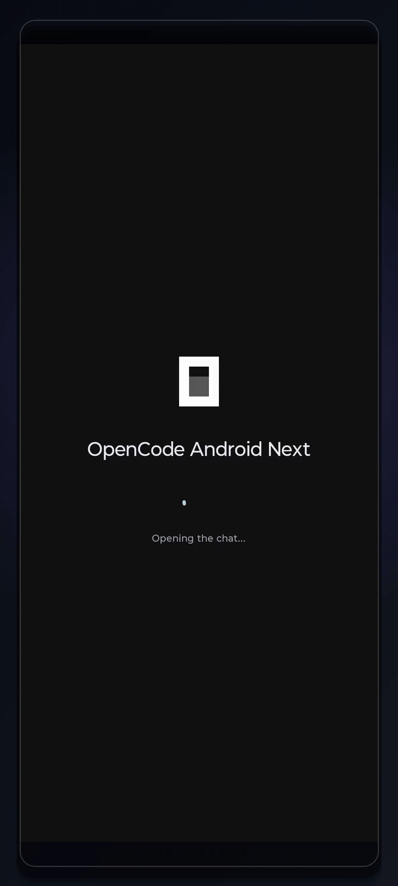
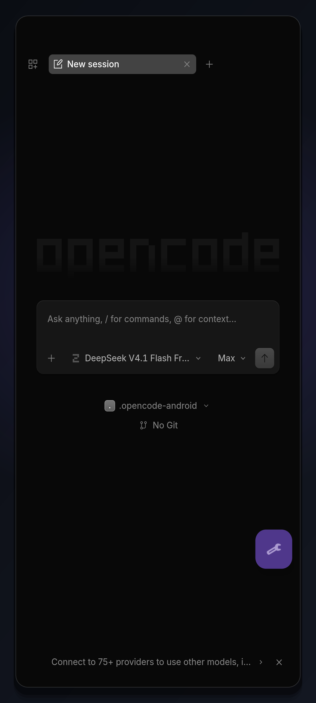
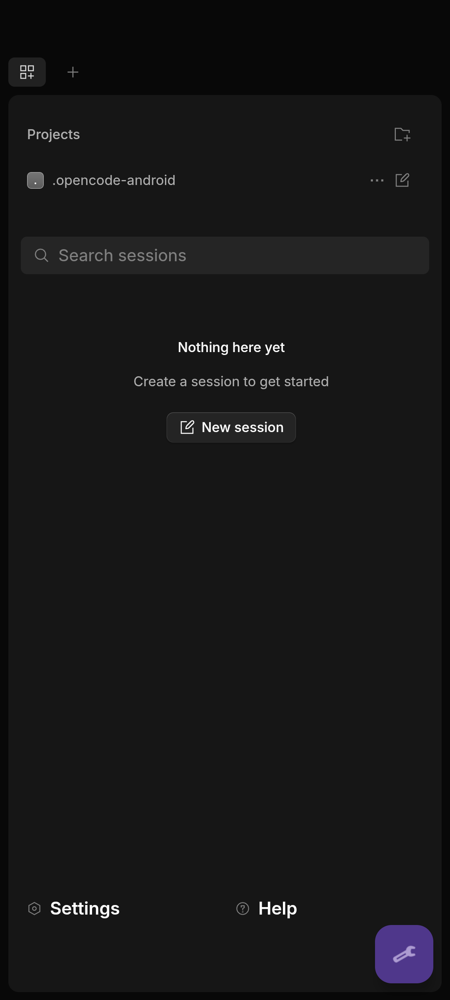
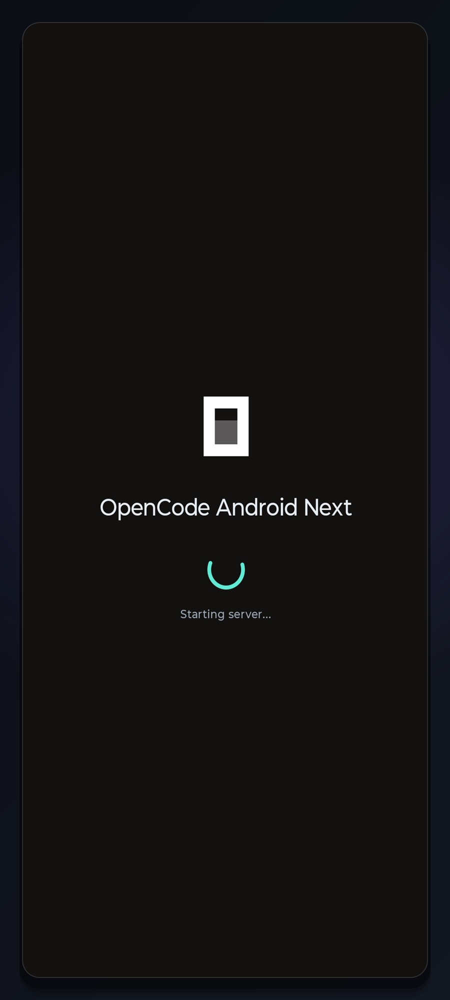

<p align="center">
  
</p>

<h1 align="center">OpenCode Android</h1>

<p align="center">The real coding agent, running natively on your phone.</p>

<p align="center">
  <a href="https://github.com/Dajeovv/opencode-android/releases"></a>
  <a href="https://github.com/Dajeovv/opencode-android/releases"></a>
  
  
  
  <a href="LICENSE"></a>
</p>

<p align="center">
  <a href="https://github.com/Dajeovv/opencode-android/releases/tag/v5.0.0"></a>
  &nbsp;&nbsp;
  <a href="https://github.com/Dajeovv/opencode-android/releases/tag/v4.0.2"></a>
</p>

<p align="center"><sub><b>v2</b> new UI &nbsp;·&nbsp; opencode 2.x &nbsp;·&nbsp; 175 MB &nbsp;&nbsp;|&nbsp;&nbsp; <b>v1</b> classic UI &nbsp;·&nbsp; opencode 1.x &nbsp;·&nbsp; 142 MB</sub></p>

<p align="center">
  <code>no Termux</code> <code>no PC</code> <code>root optional</code>
</p>

<p align="center"><sub>Unofficial Android client for <a href="https://github.com/anomalyco/opencode">opencode</a>. Not affiliated with, endorsed by, or sponsored by the upstream project.</sub></p>

> [!IMPORTANT]
> **Two editions, two APKs, installed side by side.**
> **v1** is the classic chat-first app (`com.opencode.launcher.next`, opencode 1.19.4). It updates in place from 4.0.x and keeps its sessions, projects, runtime and root grant.
> **v2** is the new 2.x interface (`com.opencode.android`, opencode 2.2.0). It is a separate app with its own private storage, so it starts fresh; v1 sessions are **not** migrated automatically.
> Both are standalone: the agent runs entirely on the phone, with no Termux, no PC and no setup.

[opencode](https://github.com/anomalyco/opencode) is a real coding agent, not just a chatbot. It can inspect and edit files, run commands, and — with wireless ADB — control apps and the UI, all from your phone.

<p align="center">
  <a href="docs/demo.gif"></a>
</p>

<p align="center"><em>v1 classic UI: opencode 1.19.4 running natively on the phone — ARM64 check, Fibonacci script, edit, and an Android toast — no Termux, no PC, no root required.</em></p>

## Choose your edition

| | **v1 — classic** | **v2 — new UI** |
|---|---|---|
| **Package** | `com.opencode.launcher.next` | `com.opencode.android` |
| **opencode** | 1.19.4 | 2.2.0 |
| **Interface** | Chat-first classic UI | New 2.x interface |
| **RAM** | Higher — classic 1.x runtime and UI | **Lower** — lighter 2.x runtime and UI |
| **Install** | Update in place from 4.0.x | Fresh install, side by side with v1 |
| **Data** | Keeps sessions, projects, runtime and root grant | New private storage; no automatic migration |
| **Updates** | 4.x app + opencode 1.x | 5.x app + opencode 2.x |
| **Best for** | Existing users and existing sessions | Trying the new interface without touching v1 |

RAM use depends on open sessions and extensions, but v2 is the lighter edition: the 2.x runtime and UI need less memory than the classic 1.x stack.

Both editions use the same release signing key, so future updates install over the same app without uninstalling it.

## Screenshots (v1 classic UI)

<table align="center">
  <tr>
    <th align="center">Chat</th>
    <th align="center">Sessions</th>
    <th align="center">Launch</th>
  </tr>
  <tr>
    <td align="center"></td>
    <td align="center"></td>
    <td align="center"></td>
  </tr>
</table>

## What you get

- **The app is the chat.** No Termux, no PC, no wizard. Open the app, the server starts by itself, and the chat appears as soon as it is healthy.
- **Native ARM64 runtime.** opencode is embedded in the APK and runs as a native process. v2 bundles 2.2.0; v1 bundles 1.19.4.
- **A full toolchain, already installed.** `git`, `python3` + `pip3`, `node`, `ssh`, `make`, `curl`, `wget`, `bash`, `coreutils`, and the real `apt`/`dpkg`/`pkg`.
- **Extensible.** `pkg install clang`, `rust`, `go`, `ffmpeg`, `cmake`… straight from the chat.
- **Phone access.** Battery, clipboard, sensors, Wi-Fi, brightness, volume, toasts, and vibration through `termux-*` commands.
- **Share to opencode.** Send text or files from any app, review the preview, choose a new or existing conversation, and add an optional instruction.
- **Self-updating within its channel.** opencode and the app update from GitHub Releases; opencode updates verify the checksum and roll back if the new binary does not start.
- **Watchdog and notifications.** Optional restart/notify if the server goes down; boot start; daily update check.
- **Optional root.** If the phone is rooted, the app can request `su` for commands that need it. Root is not required.
- **v1 is bilingual ES/EN** and follows the system language and light/dark theme. v2 ships the new English 2.x interface.

## Requirements

- Android 8.0+ (API 26), **arm64**.
- Internet on first run (npm dependencies and the package index) and for updates.
- **v2:** ~175 MB download; **v1:** ~142 MB download. The toolbox takes ~200 MB more once unpacked.
- No Termux, no PC. Root is optional.

## Installation

### v2 — new UI

1. Download `OpenCodeAndroid-v5.0.0.apk` from [Releases](https://github.com/Dajeovv/opencode-android/releases/tag/v5.0.0).
2. Open the file. If Android blocks it, allow **Install unknown apps** for your browser or file manager.
3. Install and open **OpenCode Android v2**. It installs alongside v1; both can stay on the phone.
4. Grant **All files access** when asked (Android 11+), or storage access on Android 8-10. This lets the agent read `/sdcard` and receive shared files.
5. Wait for the first run. The app unpacks the toolbox, prepares the package index, and starts the server.

v2 uses its own package and its own private storage. It does not read v1 sessions. If root is enabled, grant the new app in Magisk separately.

### v1 — classic UI

1. Download `OpenCodeAndroid-v4.0.2.apk` from [Releases](https://github.com/Dajeovv/opencode-android/releases/tag/v4.0.2).
2. Install it over an existing 4.0.x install to keep sessions, projects, runtime and root grant. The package id and signing key do not change.
3. Open **OpenCode Android** and wait for the server.

Optional integrity check:

```sh
sha256sum -c SHA256SUMS.txt
```

On Windows PowerShell:

```powershell
Get-FileHash .\OpenCodeAndroid-v5.0.0.apk -Algorithm SHA256
Get-FileHash .\OpenCodeAndroid-v4.0.2.apk -Algorithm SHA256
```

The v1 package id is `com.opencode.launcher.next`; the `.next` suffix is historical and kept so 4.x updates preserve existing data. The v2 package id is `com.opencode.android`.

## First run

- The first start needs internet: it unpacks ~200 MB of packages, runs `apt-get update`, and installs the npm dependencies used by the agent. It can take a few minutes.
- The default model is the free `opencode.ai` model. You can connect other providers from the opencode settings.
- Everything lives in the app's private storage. Uninstalling an edition removes its runtime, toolbox, and sessions. Uninstalling v1 does not touch v2, and vice versa.

## Using the app

### v1 — classic UI

- **Chat** is the home screen. The splash stays until the local server answers.
- **Controls menu** (the floating button, bottom right): log, restart server, stop server, update opencode, check for a new app version, auto-approve, options, usage, and report a problem.
- **Sessions** (grid icon): browse projects and sessions, search, or start a new session.
- **Share**: from any app, share text or files to OpenCode Android. The preview lets you pick a new or existing conversation and add an optional instruction.

### v2 — new UI

- **Home** shows projects and sessions from the new 2.x interface. Pick a project or create a session.
- **Project picker** hides the app's internal folders and offers `OpenCode.android-projects` as the shared workspace.
- **Controls menu** (the floating button, bottom right): log, restart server, stop server, check for an app update, options, and **Report problem**. There is no auto-approve switch and no Usage menu in v2: permissions are managed by the 2.x interface itself.
- **Permissions** are handled by the v2 UI. The default policy allows the tools used in normal chat; approve additional requests there.
- **Keyboard** resizes the chat so the composer stays above the keyboard on first open and after toggling it.
- **Share** is available from other apps, like v1.

### Sharing files

- Up to 10 files, 50 MB each, 100 MB total.
- Copies stay in `Downloads/opencode-shares` (or the private folder on Android 10) and are cleaned after 7 days.

## The toolbox

The APK carries the aarch64 packages and installs them on first run — no second app:

- Real `apt`, `dpkg`, and `pkg`, with a real package database and index.
- `git`, `python3` (with `pip3`), `node`, `ssh` (OpenSSH), `make`, `curl`, `wget`, `bash`, `coreutils`, `tar`, `gzip`, and their dependencies (~200 MB installed).
- `pkg install`, `pkg remove`, `pkg upgrade`, `pkg list-installed`, `pkg search`, `pkg files`.
- Anything else from the package repository on demand: `pkg install clang` (brings `gcc`, `g++`, `cc`), `rust`, `go`, `ffmpeg`, `cmake`…
- The tools run in the same sandbox as the agent, under the app's private prefix.

## Device commands

The app exposes the phone to the agent with Termux:API-compatible command names, but without a companion app:

```
termux-battery-status        # level, charging, temperature, voltage
termux-clipboard-get|set     # clipboard
termux-toast "saved"         # on-screen notice
termux-vibrate 200           # vibration
termux-brightness            # screen brightness
termux-volume [stream] [v]   # volume
termux-wifi-connectioninfo   # active network
termux-sensor-list           # device sensors
termux-sensor accelerometer  # one sensor sample
```

They return JSON, like their Termux:API counterparts. Only safe permissions are exposed: SMS, contacts, camera, microphone, location, the notification shade, and the fingerprint are intentionally left out.

`termux-wifi-connectioninfo` uses `ConnectivityManager`, `LinkProperties`, `NetworkCapabilities`, and `WifiManager`. It returns transport, IPv4/IPv6, DNS, routes, gateway, RSSI, signal level, frequency, link speed, Wi-Fi standard, DHCP data, and every visible network. SSID/BSSID are omitted because the app does not request location.

## Updates

- **opencode:** each edition checks its own line. v1 **bundles 1.19.4** and updates within 1.x (1.19.5 is already available); v2 **bundles 2.2.0** and updates within 2.x (2.2.2 is already available). Tap the notification to download the official `opencode-linux-arm64-musl` release, verify its checksum, and install it in place. The server restarts on the new binary; if it does not answer, the app rolls back to the bundled runtime.
- **The app:** v1 checks 4.x releases and v2 checks 5.x releases. The APK downloads and installs through the system installer. Neither edition offers the other channel.

## How it works

- The opencode binary is embedded in the APK and runs as a **native ARM64 process**. Core tools (`git`, `python`, `grep`, `find`…) are ELF binaries from the bundled prefix, launched through Android's `/system/bin/linker64`.
- `LD_LIBRARY_PATH` is scoped to those launches, so `dumpsys`, `pm`, `cmd`, and other system binaries load their own libraries.
- `proot` is bundled only for `pkg`/`apt`/`dpkg` and for scripts that expect the conventional prefix. If the native runtime does not become healthy, the app falls back to proot.
- The bundled packages expect the conventional prefix path, so the app mounts its own prefix there inside the sandbox. The tools see the paths they expect.
- The packages are registered with the real dpkg database, and `apt-get update` fills the index, so `apt` and `pkg` behave normally.
- Each edition uses its own server port and its own internal toolbox port, so v1 and v2 can run at the same time without fighting over the same socket.

## Permissions & privacy

- **All files access** (Android 11+): lets the agent read `/sdcard` and copies shared files to `Downloads/opencode-shares`.
- **Storage** (Android 8-10): `READ/WRITE_EXTERNAL_STORAGE` for the same access. If Android 10 keeps scoped storage, shared files go to the app's private external folder (`Android/data/<package>/files/Download/opencode-shares`), which the agent can still read.
- **Wi-Fi state**: reads transport, IPs, DNS, routes, RSSI, and link speed through Android APIs. SSID/BSSID stay hidden because location is not requested.
- **Install unknown apps**: installs APKs downloaded from Releases.
- **Notifications**: update and watchdog notices.
- **Network**: the app contacts `api.github.com` (versions and the official opencode installer) and the package/npm mirrors used to build the toolbox on first run. Prompts and code go to the model provider you configure. There is no analytics or telemetry. Diagnostics mask tokens (`sk-***`, `ghp_***`, `Bearer ***`).
- **Root is optional.** If enabled, the app uses the system `su` (Magisk/KernelSU) and the phone shows its normal grant prompt. v1 and v2 are separate apps and need separate grants.

## Known limitations

- **Test coverage**: verified on one physical Android 15 arm64 device. Android 8-14 (including the legacy storage fallback), other OEMs, tablets, and 16 KB-page devices are untested. The APK is 16 KB-aligned, but there is no 16 KB hardware evidence yet.
- **Memory**: the app and server can be memory-heavy; phones with 3 GB or less may see the server killed in the background.

## Troubleshooting

- **The chat does not open**: the first run may still be unpacking. Wait a few minutes, check the connection, and open the controls menu → **Log**. If needed, **Restart server**.
- **The retry button appears**: wait for the automatic retry or tap **Retry**. If it keeps failing, check the log and restart the server.
- **Android blocks the APK**: allow **Install unknown apps** for the app you are installing from.
- **Sharing fails**: grant All files access (Android 11+) or storage (Android 8-10); the app retries the pending share after the permission prompt.
- **The server stops in the background**: disable battery optimization for the app and keep the watchdog enabled.
- **`dumpsys`/`ip` fail**: expected without root. Use the Android APIs through `termux-wifi-connectioninfo`.
- **Root shows “no” or “denied”**: check Magisk → Superuser access. It must allow apps (not ADB-only), and the app must be granted. v1 and v2 have different UIDs.
- **Low memory**: close other apps; the agent and server are heavy.

## Contributing

Issues and pull requests are welcome — see [CONTRIBUTING.md](CONTRIBUTING.md) and the [Code of Conduct](CODE_OF_CONDUCT.md). Security reports go through the private channel in [SECURITY.md](SECURITY.md). Human authorship of this AI-assisted project is documented in [AUTHORSHIP.md](AUTHORSHIP.md).

## License

MIT — see [LICENSE](LICENSE).
