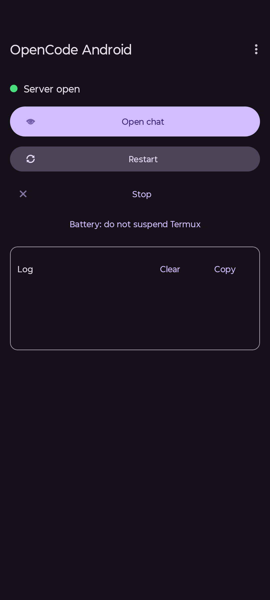

# OpenCode Android

Android launcher for [opencode](https://github.com/anomalyco/opencode) running on Termux: one tap opens the chat on your phone, with guided setup, background updates with real progress, and update notifications.

**[First time here? Jump to installation](#user-content-installation)** — includes the 3-part video tutorial (Español / English).

## Screenshots

| Launch | Panel |
|---|---|
|  |  |
| Sessions | Chat |
|  |  |

## Features

- **One-tap chat**: starts `opencode serve` in Termux and opens the local UI (`http://127.0.0.1:4096`).
- **First-run wizard**: guides you with or without root (installs Termux, configures permissions, installs opencode).
- **Background opencode updates**: downloads with real MB progress, no frozen screen; auto-restarts when done.
- **Update notifications**: panel button + system notification (even with the app closed, daily check), for new opencode releases and for new versions of this app.
- **Optional watchdog**: notifies or restarts if the server goes down; boot start.
- **Bilingual ES/EN**, follows the system light/dark theme.

## Requirements

- Android 8.0+ (API 26). Tested on Android 15.
- [Termux](https://github.com/termux/termux-app) (the app downloads it if missing).
- Internet connection for the first install and updates.

## Installation

> [!TIP]
> **First time installing? Watch the video tutorial first.** It walks through Termux, permissions and the wizard, step by step.
>
> **This setup is done only once.** After that, just open the app and tap **Start and open**.

### Video tutorial

<b>Video tutorial — Español</b> (3 parts)

Parte 1/3

https://github.com/user-attachments/assets/bab76268-42b4-4039-81fc-2e3e1e0ab68f

Parte 2/3

https://github.com/user-attachments/assets/f031866f-45fd-4493-bfd5-fe5abc8a8b55

Parte 3/3

https://github.com/user-attachments/assets/30d25b2b-4df4-4871-ac3d-e75c7ffaa7a7

Full quality: [install-es.mp4](https://github.com/Dajeovv/opencode-android/releases/download/install-videos/install-es.mp4)

<b>Video tutorial — English</b> (3 parts)

Part 1/3

https://github.com/user-attachments/assets/eebc8aed-2833-441e-b2a3-b4c7716df40a

Part 2/3

https://github.com/user-attachments/assets/1106b77f-78a7-4408-9c00-1528e2e1da4d

Part 3/3

https://github.com/user-attachments/assets/7def2639-9e16-4b57-95fd-ec8cfca79cdb

Full quality: [install-en.mp4](https://github.com/Dajeovv/opencode-android/releases/download/install-videos/install-en.mp4)

1. Download the APK from the latest [Release](../../releases) and install it.
2. Open the app and follow the wizard (it will ask for 2–3 permissions).
3. Tap **Start and open**.

> On some phones you must enable "Install unknown apps" and "All files access" in Settings; the app takes you there.

## Updates

- **opencode**: the app checks GitHub every 24 h (and on every open). When a new version is out, an `Update opencode X → Y` button appears plus a notification.
- **this app**: same, with a `New app version X — Download` button + notification. The APK downloads from the GitHub Release itself and installs via the system installer.

## Permissions & privacy

- **All files access**: reads the installed version and Termux progress markers.
- **Install unknown apps**: installs the APK downloaded from a Release.
- **Notifications**: update and watchdog notices.
- Nothing leaves your phone except public queries to `api.github.com` (versions) and opencode installer downloads. Diagnostics mask tokens (`sk-***`, `ghp_***`, `Bearer ***`) before display.

## Build from source

- JDK 17, Android SDK with `compileSdk 34`; the repo ships the Gradle wrapper (Gradle 8.7 + Android Gradle Plugin 8.5.2).
- Create `local.properties` with `sdk.dir=/path/to/your/sdk` (never committed).
- Debug: `./gradlew :app:assembleDebug` (the first run downloads dependencies).
- Signed release: `./gradlew :app:assembleRelease` (needs a `keystore.properties` next to this README with `storeFile`, `storePassword`, `keyAlias` and `keyPassword`; that file is never committed — keep a copy of the `.jks` and its passwords outside the repo).

## Known limitations

- On some phones the app freezer can pause long background downloads (see the watchdog interval).
- The direct "install unknown apps" screen does not exist on all vendors: the app falls back to the app-details page, where the same toggle lives.

## Contributing

Issues and pull requests are welcome — see [CONTRIBUTING.md](CONTRIBUTING.md) and the [Code of Conduct](CODE_OF_CONDUCT.md). Security reports go through the private channel described in [SECURITY.md](SECURITY.md). Human authorship of this AI-assisted project is documented in [AUTHORSHIP.md](AUTHORSHIP.md).

## License

MIT — see [LICENSE](LICENSE).
