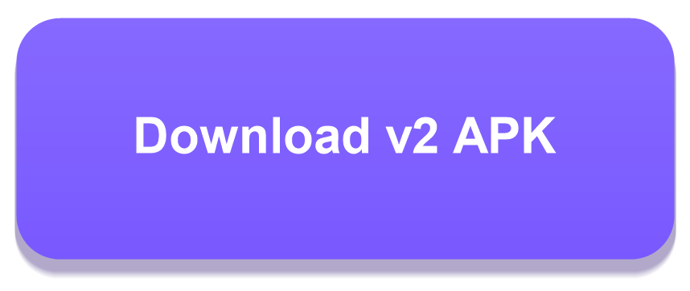

  

<h1 align="center">OpenCode Android</h1>

The real coding agent, running natively on your phone.

  
  
  
  
  
  

  
  &nbsp;&nbsp;
  

<b>v2</b> new UI &nbsp;·&nbsp; opencode 2.x &nbsp;&nbsp;|&nbsp;&nbsp; <b>v1</b> classic UI &nbsp;·&nbsp; opencode 1.x

  <code>no Termux</code> <code>no PC</code> <code>root optional</code>

Unofficial Android client for <a href="https://github.com/anomalyco/opencode">opencode</a>. Not affiliated with, endorsed by, or sponsored by the upstream project.

> [!IMPORTANT]
> **Two editions, two APKs, installed side by side.**
> **v1** is the classic chat-first app (`com.opencode.launcher.next`, opencode 1.19.4). It updates in place from 4.0.x and keeps its sessions, projects, runtime and root grant.
> **v2** is the new 2.x interface (`com.opencode.android`, opencode 2.2.0). It is a separate app with its own private storage, so it starts fresh; v1 sessions are **not** migrated automatically.
> Both are standalone: the agent runs entirely on the phone, with no Termux, no PC and no setup.

[opencode](https://github.com/anomalyco/opencode) is a real coding agent, not just a chatbot. It can inspect and edit files, run commands, and — with wireless ADB — control apps and the UI, all from your phone.

  
  &nbsp;&nbsp;
  

## Choose your edition

| | **v1 — classic** | **v2 — new UI** |
|---|---|---|
| **Package** | `com.opencode.launcher.next` | `com.opencode.android` |
| **opencode** | 1.19.4 (updates within 1.x) | 2.2.0 (updates within 2.x) |
| **Terminal** | — | Integrated shell (pkg, apt, git, python) |
| **WARP** | — | Cloudflare WARP for opencode.ai |
| **Remote server** | — | Connect to a PC via QR code or pairing link |
| **Install** | Update in place from 4.0.x | Fresh install, side by side with v1 |
| **Data** | Keeps sessions, projects, runtime and root grant | New private storage; no automatic migration |
| **Best for** | Existing users and existing sessions | Trying the new interface without touching v1 |

Both editions use the same release signing key, so future updates install over the same app without uninstalling it.

## What you get

- **The app is the chat.** No Termux, no PC, no wizard. Open the app, the server starts by itself, and the chat appears as soon as it is healthy.
- **Native ARM64 runtime.** opencode is embedded in the APK and runs as a native process. v2 bundles 2.2.0; v1 bundles 1.19.4.
- **A full toolchain, already installed.** `git`, `python3` + `pip3`, `node`, `ssh`, `make`, `curl`, `wget`, `bash`, `coreutils`, `apt`/`pkg`.
- **Extensible.** `pkg install clang`, `rust`, `go`, `ffmpeg`, `cmake`… straight from the chat.
- **Phone access.** Battery, clipboard, sensors, Wi-Fi, brightness, volume, toasts, and vibration through `termux-*` commands.
- **Share to opencode.** Send text or files from any app, review the preview, choose a new or existing conversation, and add an optional instruction.
- **Integrated terminal.** A real interactive shell inside the app: pkg, apt, git, python and more, with touch scrolling.
- **Optional WARP.** Route opencode.ai traffic through Cloudflare WARP, toggle it from the controls menu.
- **Self-updating within its channel.** opencode and the app update from GitHub Releases; opencode updates verify the checksum and roll back if the new binary does not start.
- **Optional root.** If the phone is rooted, the app can request `su` for commands that need it. Root is not required.

## Requirements

- Android 8.0+ (API 26), **arm64**.
- Internet access. The first run installs the npm dependencies and the package index; updates use it too.
- The toolbox takes ~200 MB more once unpacked.
- No Termux, no PC. Root is optional.

## First run

- The first start unpacks ~200 MB of packages, runs `apt-get update`, and installs the npm dependencies used by the agent. It can take a few minutes.
- The default model is the free `opencode.ai` model. You can connect other providers from the opencode settings.
- Grant **All files access** when asked (Android 11+), or storage access on Android 8-10, so the agent can read `/sdcard` and receive shared files.
- Everything lives in the app's private storage. Uninstalling an edition removes its runtime, toolbox, and sessions. Uninstalling v1 does not touch v2, and vice versa.

## Using the app

### v2 — new UI

- **Home** shows projects and sessions. Pick a project or create a session.
- **Controls menu** (floating button, bottom right): log, restart server, stop server, update opencode (if available), check/download app update, built-in WARP toggle + change IP, choose OpenCode version, options, and **Report problem**.
- **Permissions** are handled by the v2 UI. The default policy allows the tools used in normal chat.
- **Keyboard** resizes the chat so the composer stays above the keyboard.
- **Share** is available from other apps, like v1.

### v1 — classic UI

- **Chat** is the home screen. The splash stays until the local server answers.
- **Controls menu** (floating button, bottom right): log, restart server, stop server, update opencode, check for a new app version, auto-approve, options, usage, and report a problem.
- **Sessions** (grid icon): browse projects and sessions, search, or start a new session.
- **Share**: from any app, share text or files to OpenCode Android.

### Sharing files

- Up to 10 files, 50 MB each, 100 MB total.
- Copies stay in `Downloads/opencode-shares` (or the private folder on Android 10) and are cleaned after 7 days.

## The toolbox

The APK carries the aarch64 packages and installs them on first run — no second app, no Termux required:

- Real `apt`, `dpkg`, and `pkg`, with a real package database and index.
- `git`, `python3` (with `pip3`), `node`, `ssh`, `make`, `curl`, `wget`, `bash`, `coreutils`, and more.
- `pkg install`, `pkg remove`, `pkg upgrade`, `pkg list-installed`, `pkg search`.
- Anything else from the package repository on demand: `pkg install clang`, `rust`, `go`, `ffmpeg`, `cmake`…
- The tools run in the same sandbox as the agent, under the app's private prefix.
- The integrated terminal runs in this same environment, so `pkg`, `apt`, `git` and `python` work as they do in Termux.
- Packages update with `apt-get update` / `pkg upgrade` like on a normal Linux system.

## Updates

- **opencode runtime:** updates are checked automatically within the edition's channel (1.x for v1, 2.x for v2). You can also pick any version from the bundled one up to the latest from the controls menu. Checksums are verified and the app rolls back if the new binary doesn't start.
- **The app:** v1 checks 4.x releases, v2 checks 5.x releases. The APK downloads through the system installer.

## How it works

The opencode binary is embedded in the APK and runs as a **native ARM64 process**. Core tools are ELF binaries from the bundled prefix, launched through Android's `/system/bin/linker64`. `proot` is bundled only for `pkg`/`apt`/`dpkg`. Each edition uses its own server port and toolbox port, so v1 and v2 can run at the same time.

## Permissions & privacy

- **All files access** (Android 11+): lets the agent read `/sdcard` and copies shared files to `Downloads/opencode-shares`.
- **Storage** (Android 8-10): `READ/WRITE_EXTERNAL_STORAGE` for the same access.
- **Wi-Fi state**: reads transport, IPs, DNS, routes, RSSI, and link speed. SSID/BSSID stay hidden because location is not requested.
- **Install unknown apps**: installs APKs downloaded from Releases.
- **Network**: the app contacts `api.github.com` (versions and the official opencode installer) and the package/npm mirrors used to build the toolbox on first run. Prompts and code go to the model provider you configure. There is no analytics or telemetry. Diagnostics mask tokens (`sk-***`, `ghp_***`, `Bearer ***`).
- **Root is optional.** If enabled, the app uses the system `su` (Magisk/KernelSU). v1 and v2 are separate apps and need separate grants.

## Known limitations

- **Test coverage**: verified on one physical Android 15 arm64 device. Android 8-14, other OEMs, tablets, and 16 KB-page devices are untested. The APK is 16 KB-aligned, but there is no 16 KB hardware evidence yet.

## Troubleshooting

- **The chat does not open**: the first run may still be unpacking. Wait a few minutes, check the connection, and open the controls menu → **Log**. If needed, **Restart server**.
- **The retry button appears**: wait for the automatic retry or tap **Retry**. If it keeps failing, check the log and restart the server.
- **Android blocks the APK**: allow **Install unknown apps** for the app you are installing from.
- **Sharing fails**: grant All files access (Android 11+) or storage (Android 8-10); the app retries the pending share after the permission prompt.
- **The server stops in the background**: disable battery optimization for the app and keep the watchdog enabled.
- **`dumpsys`/`ip` fail**: expected without root. Use the Android APIs through `termux-wifi-connectioninfo`.
- **Root shows "no" or "denied"**: check Magisk → Superuser access. It must allow apps (not ADB-only), and the app must be granted. v1 and v2 have different UIDs.

## Contributing

Issues and pull requests are welcome — see [CONTRIBUTING.md](CONTRIBUTING.md). Security reports go through [SECURITY.md](SECURITY.md).

## License

MIT — see [LICENSE](LICENSE).